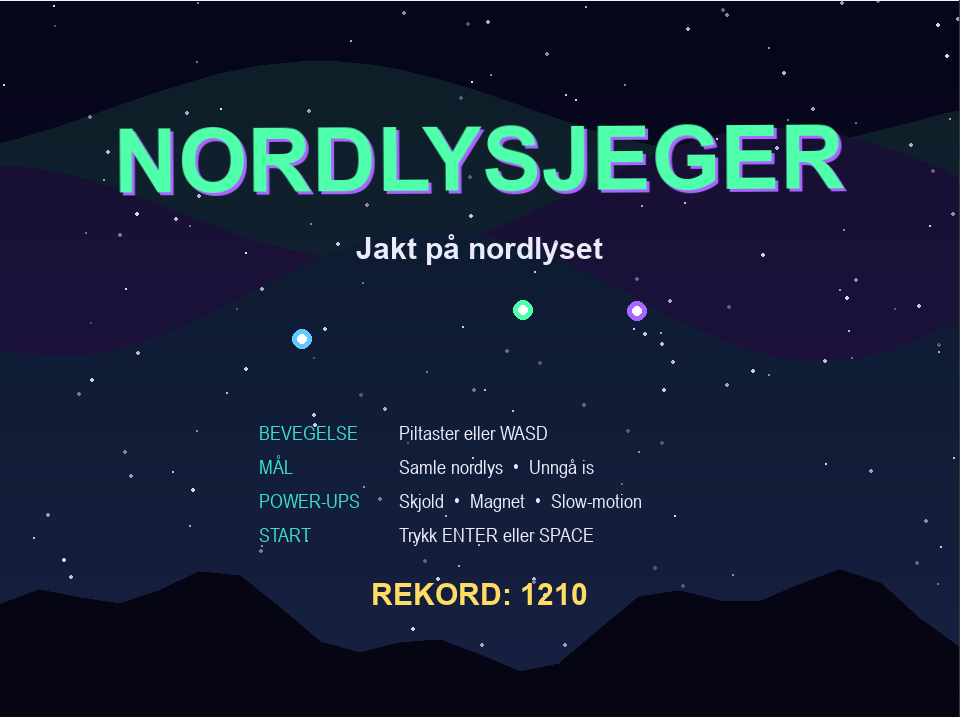
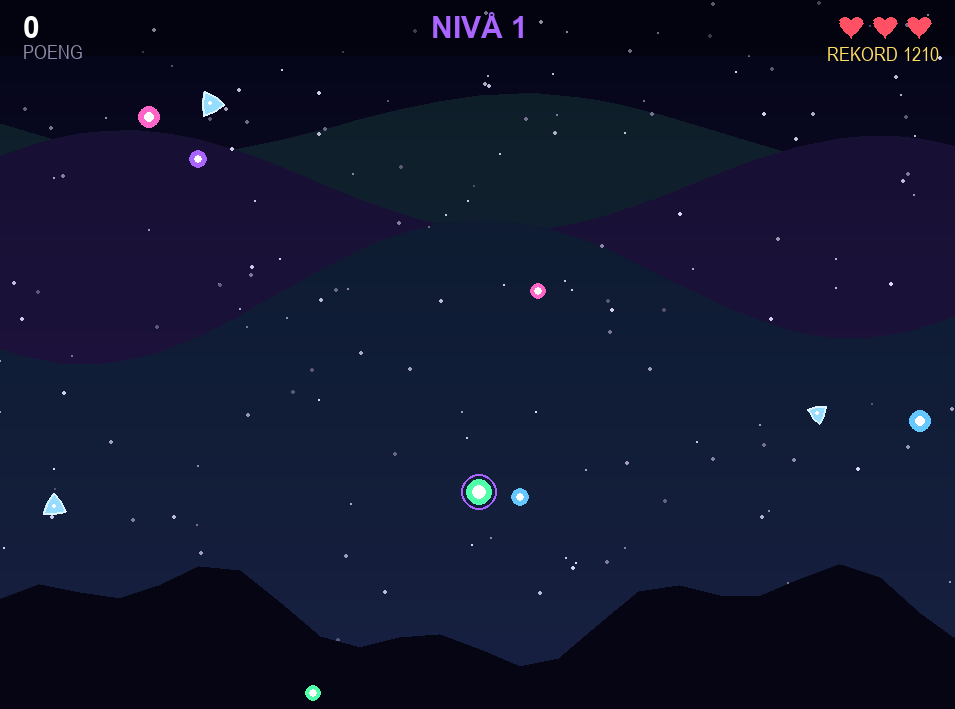
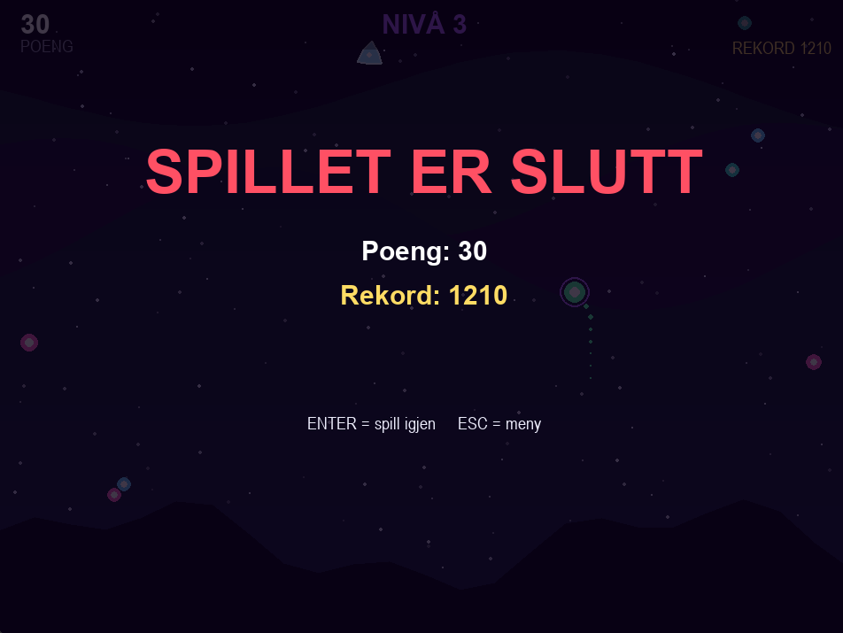

# Nordlysjeger

Et 2D-arkadespill laget med Python og Pygame-CE. Du styrer en lysende nordlys-ånd over en mørk stjernehimmel. Målet er å samle nordlys-partikler, unngå iskrystaller og få så mange poeng som mulig før du mister alle livene dine.

## Skjermbilder

**Startmeny**

| Startmeny                | Spillet                     | Game over                       |
| ------------------------ | --------------------------- | ------------------------------- |
|  |  |  |

## Hva går spillet ut på?

- Nordlys-partikler (fargede kuler) faller ned fra toppen av skjermen. Fang dem for **10 poeng** hver.
- Iskrystaller (blå sekskanter) faller også. Treffer du én, mister du **ett liv**. Du starter med **3 liv**.
- Fanger du partikler raskt etter hverandre, bygger du en **combo** som gir bonuspoeng.
- Hvert 20. sekund går du opp ett **nivå**. Da faller objektene raskere og dukker opp oftere.
- Rekorden din lagres i filen `highscore.txt`.

## Hvordan starte spillet

Du trenger **Python 3.10 eller nyere**.

1. Åpne prosjektmappen i Visual Studio Code (eller en terminal i mappen).
2. Installer avhengighetene:
   ```bash
   pip install -r requirements.txt
   ```
3. Start spillet fra prosjektmappen:
   ```bash
   python main.py
   ```

## Slik spiller du

| Tast                        | Handling                 |
| --------------------------- | ------------------------ |
| Piltaster eller **W A S D** | Beveg spilleren          |
| **ENTER** eller **SPACE**   | Start spillet (i menyen) |
| **P** eller **ESC**         | Pause / fortsett         |
| **Q** (i pausemenyen)       | Tilbake til startmenyen  |
| **ENTER** (etter game over) | Spill igjen              |
| **ESC** (etter game over)   | Tilbake til menyen       |

## Power-ups

Av og til faller det ned en roterende firkant. Plukk den opp for en midlertidig effekt:

| Power-up        | Symbol  | Effekt                                       | Varighet   |
| --------------- | ------- | -------------------------------------------- | ---------- |
| **Skjold**      | Ring    | Iskrystaller ødelegges uten at du mister liv | 6 sekunder |
| **Magnet**      | Pluss   | Nordlys-partikler i nærheten trekkes mot deg | 7 sekunder |
| **Slow-motion** | Trekant | Nye objekter faller saktere                  | 4 sekunder |

Aktive power-ups vises som små sirkler med nedtelling nede til venstre på skjermen.

## Poeng og combo

- Hver partikkel gir 10 poeng ganger combo-multiplikatoren.
- Combo øker for hver partikkel du fanger innen 1,5 sekund etter forrige. For hver 5. partikkel i rekke øker multiplikatoren med 0,5x.
- Combo nullstilles hvis du ikke fanger noe på 1,5 sekund, eller hvis du blir truffet av is.
