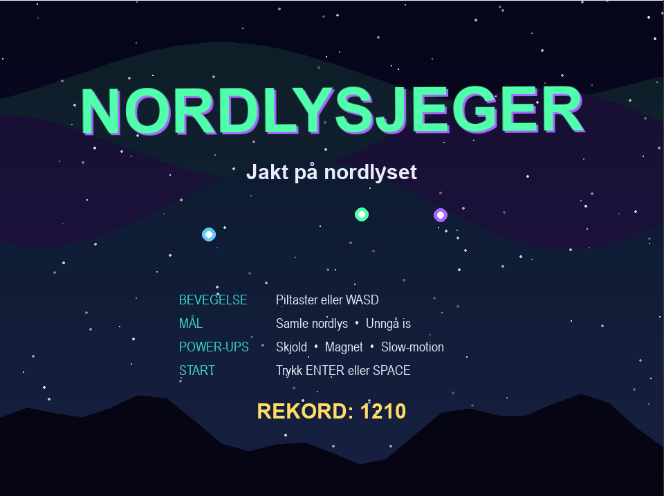
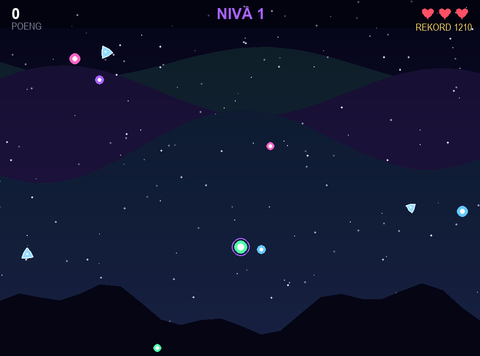
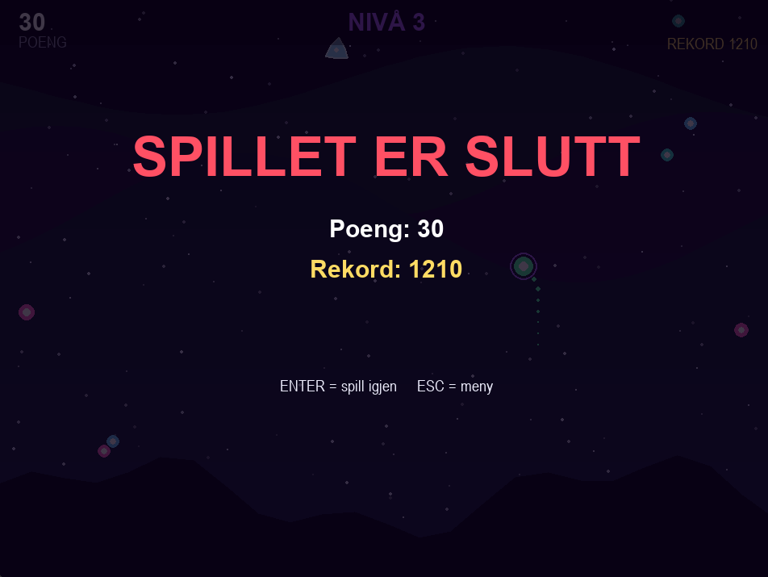

# Dokumentasjon og arbeidslogg: Nordlysjeger

**Elev:** Zhanna
**Fag:** Yrkesfaglig fordypning vg1
**Prosjekt:** Lag ditt eget spill
**Periode:** 3 onsdager (14., 21. og 28. oktober 2026) + eget arbeid hjemme
**Verktøy:** Python 3 og Pygame-CE, skrevet i Visual Studio Code

---

## 1. Idé og planlegging

### Hva handler spillet om?
Nordlysjeger er et 2D-arkadespill der spilleren styrer en lysende nordlys-ånd over en mørk stjernehimmel. Jeg ville lage noe med et tydelig norsk preg. Valget falt på nordlys, fordi det er visuelt kult og lar meg bruke mørke farger med sterke neon-aksenter (grønn, blå, lilla).

### Hvem er målgruppen?
Spillet er for ungdom og voksne som liker enkle arkadespill de kan spille i korte økter. Reglene forklares på startskjermen, og kontrollene er enkle (piltaster eller WASD), så alle kan komme i gang med en gang.

### Hva er målet i spillet?
Spilleren skal bevege seg fritt, samle nordlys-partikler for poeng og unngå iskrystaller som faller ned. Spilleren har 3 liv, og farten øker over tid for å gjøre spillet vanskeligere. Målet er å slå sin egen rekord.

### Hvilke mekanikker er med?
| Mekanikk | Beskrivelse |
| --- | --- |
| Bevegelse | Piltaster eller WASD, med normalisert diagonal fart |
| Poengsystem | 10 poeng per nordlys-partikkel, ganger en combo-multiplikator |
| Liv | 3 liv, vises som hjerter øverst til høyre |
| Kollisjoner | Mellom spilleren og partikler, iskrystaller og power-ups |
| Nivåer | Nytt nivå hvert 20. sekund, med raskere og hyppigere objekter |
| Power-ups | Skjold, magnet og slow-motion |
| Tidtaking | Timere for spawning, combo, nivå og power-ups |
| Menyer | Startmeny, pausemeny og game over-skjerm |
| Rekord | Highscore lagres i `highscore.txt` |
| Lyd | Lydeffekter som lages i koden |

### Hvordan skal spillet se ut?
Mørk nattehimmel med gradient, stjerner som beveger seg i tre lag, bølgende nordlys i bakgrunnen og fjell i silhuett nederst. Spilleren er en lysende sirkel, nordlys-partiklene er fargede kuler, og iskrystallene er blå roterende sekskanter. Alt er tegnet med geometriske figurer i Pygame, uten bildefiler.

---

## 2. Valg av verktøy

Jeg valgte **Python med Pygame-CE**. Jeg vurderte Unity, men siden jeg allerede kunne litt Python, følte jeg at Pygame var lettere å få til i løpet av de tre øktene. Jeg skrev koden i Visual Studio Code.

**Utfordring med installasjonen:** Da jeg skulle installere Pygame, fikk jeg en stor feilmelding i terminalen. Det viste seg at den vanlige `pygame`-pakken ikke støttet den nyeste Python-versjonen min. Jeg fant ut at jeg måtte bruke `pygame-ce` (Community Edition) i stedet. Etter det fungerte alt.

---

## 3. Arbeidslogg

### Onsdag 14. oktober: Planlegging og oppsett

**Mål for økten:** Bestemme ideen, velge verktøy og få et grunnleggende vindu på skjermen.

Jeg startet med å bestemme hva spillet skulle handle om. Jeg bestemte at det skulle være 3 liv, og at farten skulle øke over tid for å gjøre det vanskeligere.

Jeg opprettet prosjektmappen i VS Code og lagde filen `main.py`. Her skrev jeg koden for å starte Pygame, sette opp et vindu og få en `while`-løkke til å kjøre i 60 FPS. Vinduet var først 800x600. Nå ligger størrelsen i `settings.py`, og spillet kjører i 960x720.

### Onsdag 21. oktober: Utvikling av kjernefunksjonalitet

**Mål for økten:** Få spilleren til å bevege seg, få objekter til å falle, og få kollisjoner til å fungere.

Jeg begynte å lage klassen `Player`. Først fikk jeg en firkant til å bevege seg med piltastene, men jeg byttet den raskt ut med en sirkel for å få en mer «åndelig» look. Bak spilleren la jeg en lysende hale av små partikler, og rundt sirkelen tegnet jeg ringer i forskjellige farger.

Deretter lagde jeg klassene `AuroraParticle` (nordlys) og `IceShard` (iskrystall). Jeg la inn en timer (`spawn_timer`) som bestemmer hvor ofte de skal dukke opp på toppen av skjermen. Jeg fikk dem til å falle nedover i varierende hastighet.

Så kom den viktigste delen: **kollisjoner**. Jeg brukte `pygame.Rect` og `colliderect()` for å sjekke om spilleren traff et objekt. Hvis spilleren traff nordlys, økte poengsummen og nordlyset ble fjernet. Hvis spilleren traff is, trakk jeg fra ett liv.

Mot slutten av økten la jeg til en highscore-funksjon som lagrer poengsummen til en tekstfil (`highscore.txt`), og en game over-skjerm.

### Onsdag 28. oktober: Polering, feilsøking og eget arbeid hjemme

**Mål for økten:** Gjøre spillet morsommere med power-ups, legge til menyer og finpusse koden.

Spillet fungerte, men det ble litt kjedelig i lengden. Derfor la jeg til flere ting:

- **Power-ups:** Jeg lagde tre typer: skjold (iskrystaller ødelegges uten at jeg mister liv), magnet (drar til seg nordlys) og slow-motion (nye objekter faller saktere). Skjold og magnet bruker nedtellings-timere i `Player`-klassen. Slow-motion-timeren ligger i `Game`. Timerne teller frames, f.eks. 6 sekunder = 360 frames ved 60 FPS.
- **Combo og nivåer:** Fanger man partikler raskt etter hverandre, gir det en multiplikator på poengene. Hvert 20. sekund går man opp ett nivå, og da faller objektene raskere og dukker opp oftere.
- **Menyer:** Startmeny med forklaring av kontrollene, og en pausefunksjon (P eller ESC).
- **Effekter:** Partikkel-eksplosjoner når man fanger noe, flytende poengtekst, skjermristing og fargeblink når man blir truffet, og en stjernehimmel som beveger seg i tre lag.
- **Lyd:** Lydeffektene lages i koden (`audio.py`), så jeg trengte ingen lydfiler.

**Arbeid hjemme:** Jeg innså ganske raskt at 3 dager på skolen ikke var nok for å bli helt ferdig med alt jeg ville. Derfor jobbet jeg en god del med prosjektet hjemme på kveldstid. Det var hjemme jeg fikk tid til å sitte skikkelig med feilsøking og rydde i koden. Jeg flyttet alt av innstillinger (farger, skjermstørrelse, hastigheter) til en egen fil (`settings.py`), og delte opp resten i moduler (`game.py`, `player.py`, `objects.py`, `powerups.py`, `particles.py` og `audio.py`). Dette gjorde filene mye kortere og lettere å lese. Å jobbe hjemme gjorde at jeg fikk brukt mye mer tid på detaljer, som glødeeffekter og hvordan menyen skulle se ut.

---

## 4. Utfordringer og hvordan jeg løste dem

| Utfordring | Løsning |
| --- | --- |
| `pygame` kunne ikke installeres på min Python-versjon | Jeg byttet til `pygame-ce` (Community Edition) |
| **Diagonal bevegelse:** Når jeg holdt inne to piltaster (f.eks. opp og høyre), gikk spilleren mye fortere enn vanlig | Jeg googlet og fant ut at bevegelsen må normaliseres. Jeg fikset det ved å gange farten med 0,7071 når man beveger seg diagonalt |
| **Objekter som ikke forsvant:** Nordlys og is som gikk utenfor skjermen ble hengende i minnet. Da jeg prøvde å fjerne dem fra listen mens jeg gikk gjennom den, kræsjet spillet eller hoppet over objekter | Jeg skjønte at man ikke kan fjerne elementer fra en liste mens man går gjennom den. Jeg løste det ved å gå gjennom en kopi av listen (`for x in liste[:]`) |
| Koden ble lang og uoversiktlig i én fil | Jeg delte koden i moduler og flyttet innstillinger til `settings.py` |

---

## 5. Testing

Jeg spilte spillet mange ganger selv for å teste.

- Fungerer kollisjonene riktig? Ja.
- Lagres rekorden når jeg dør? Ja.
- Fungerer pausefunksjonen? Ja.
- Kan man jukse ved å holde seg i et hjørne? Iskrystallene dukker opp tilfeldig over nesten hele bredden av skjermen, så det er vanskelig å gjemme seg.
- Fungerer power-ups og timerne deres? Ja, de vises nede til venstre med nedtelling.

---

## 6. Skjermbilder

| Startmeny | Spillet | Game over |
| --- | --- | --- |
|  |  |  |

---

## 7. Ressurser

- **Pygame-CE, offisiell dokumentasjon:** https://pyga.me/docs/
- **Pygame-CE, nettside:** https://pyga.me
- **Pygame-CE, nybegynnerguide:** https://pyga.me/docs/tutorials/en/newbie-guide.html
- **Python, offisiell dokumentasjon:** https://docs.python.org/3/
- **YouTube, freeCodeCamp:** https://www.youtube.com/@freecodecamp. Videoer om Pygame og spill-løkke.
- **YouTube, Tech With Tim:** https://www.youtube.com/@TechWithTim. Videoer om Pygame, klasser og kollisjoner.

---

## 8. Bruk av KI

Jeg skrev og testet mesteparten av koden selv, men jeg brukte KI (Microsoft Copilot) som en hjelpelærer når jeg sto fast. Jeg brukte det aldri til å generere hele spillet, men heller til å forstå feilmeldinger og finne riktig tilnærming.

### Hva brukte jeg KI til?
Feilsøking, forklaring av feilmeldinger og å finne riktig tilnærming til konkrete problemer.

### Eksempler på spørsmål (prompter)

| Spørsmål jeg stilte | Svaret | Hvordan jeg brukte det |
| --- | --- | --- |
| «Hvordan kan jeg sørge for at diagonal bevegelse ikke blir raskere enn vanlig bevegelse i Pygame?» | Jeg måtte gange farten med 0,7071 | Jeg la inn dette i `Player.update()` |
| «Vanlig pygame feiler under installasjon på den nye Python-versjonen min. Hva er løsningen?» | Bytt til `pygame-ce` | Jeg installerte `pygame-ce` og la det i `requirements.txt` |
| «Hva er den beste måten å lage en Pause-funksjon i en while-løkke?» | Bruk en `game_state`-variabel i stedet for å stoppe løkken helt | Jeg lagde variabelen `self.state` med verdiene `menu`, `playing`, `paused` og `gameover` |

### Hvordan vurderte og bearbeidet jeg svarene?
Jeg leste alltid forklaringene fra KI for å forstå *hvorfor* det fungerte, og testet deretter løsningene i min egen kode. Jeg merket at KI noen ganger foreslo løsninger som ikke passet helt med strukturen min. Da måtte jeg justere det selv.

### Hva lærte jeg, og hvilke begrensninger så jeg?
- KI er et veldig bra verktøy for å komme videre når man står fast, spesielt med feilmeldinger.
- KI kjenner ikke hele prosjektet mitt, så svarene kan ikke limes rett inn. Jeg må forstå koden selv for å tilpasse den.
- Jeg lærte mer av å forstå *hvorfor* en løsning fungerte enn av selve løsningen.

---

## 9. Egenvurdering

**Hvor fornøyd er jeg med resultatet?**
Jeg er godt fornøyd med resultatet og følelsen spillet gir. Spillet har en tydelig stemning, og det fungerer fra start til slutt med meny, pause, game over og rekord.

**Hva fungerer godt?**
Kollisjonene, menyene og pausefunksjonen fungerer som de skal, og rekorden lagres mellom hver gang man spiller. Power-ups, combo og nivåer gjør spillet morsommere over tid. Jeg synes også utseendet ble bra, med nattehimmel, nordlys og effekter. Kodestrukturen med moduler gjør koden lett å lese.

**Hva kunne vært bedre?**
- Hvis jeg skulle gjort dette igjen, ville jeg tegnet mer grafikk selv (f.eks. sprites) i stedet for å bruke geometriske figurer.
- Slow-motion påvirker bare objekter som dukker opp etter at power-upen er tatt, ikke de som allerede faller.
- Det er ingen knapp for å skru av lyden.

**Hva ville jeg utviklet videre hvis jeg hadde mer tid?**
Egen grafikk og animasjoner (sprites), flere typer power-ups og hindringer, og ekte musikk i stedet for bare lydeffekter.

**Hvordan jobbet jeg når jeg møtte utfordringer?**
Jeg prøvde først å finne ut av det selv ved å teste og lese feilmeldingen, og googlet. Deretter så jeg tutorials på YouTube. Når jeg fortsatt sto fast, spurte jeg KI og testet svaret i min egen kode. Jeg jobbet også hjemme når jeg trengte mer tid til feilsøking.

**Brukte jeg KI? Hvordan, og hvor nyttig var det?**
Ja, jeg brukte KI som hjelpelærer når jeg sto fast, og til å forenkle noen vanskelige deler av koden slik at jeg forsto dem. Jeg brukte det ikke til å lage hele spillet. Det var veldig nyttig til feilsøking og til å forstå feilmeldinger, men svarene måtte tilpasses koden min.

**Hva har jeg lært?**
Jeg har gått fra å bare kunne grunnleggende Python til å forstå hvordan man bygger opp et objektorientert system med klasser, hvordan man håndterer kollisjoner i 2D, og hvordan man feilsøker kode som ikke gjør som man vil. Den største lærdommen er at det å dele koden inn i mindre filer (moduler) er helt avgjørende når prosjektet vokser. Det gjorde feilsøkingen mye enklere på slutten. Jeg har også lært at det å jobbe hjemme og oppsøke hjelp (både via YouTube og KI) når man står fast, er helt nødvendig for å bli ferdig med et større prosjekt.
